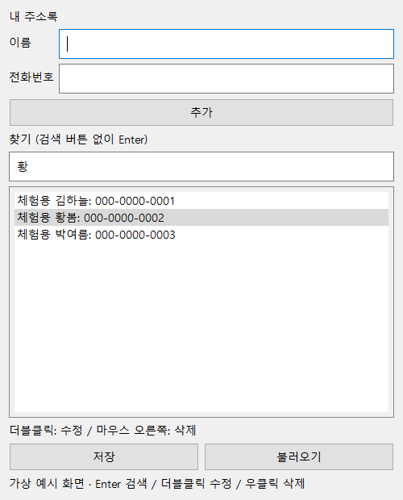

# PyQt5 주소록

PPT 36~51쪽의 주소록 실습을 구현했습니다.

- 이름·전화번호 추가 및 중복 이름 검사
- 이름 일부 또는 전화번호 검색, Enter로 실행
- 검색 결과 여러 항목 선택·강조 및 첫 결과로 스크롤
- 더블클릭 EditDialog 수정
- 우클릭 메뉴 삭제, 확인 창
- 저장·불러오기: 소스 옆 addbook.txt, 파일 선택창 없음
- UTF-8 CSV 형식으로 쉼표가 들어간 이름도 보존
- 잘못된 파일은 현재 목록을 덮어쓰지 않음
- 저장하지 않은 변경을 버리기 전 확인

## 실행

`pip install -r requirements.txt` 후 `python addressBook.py`.
이 컴퓨터에서는 `run.cmd` 더블클릭. 다른 컴퓨터는 `conda env create -f environment.yml` 후 `conda activate addressbook`.

addbook.txt는 실제 연락처가 담길 수 있어 Git에 포함하지 않습니다. 화면 예시는 가상 데이터입니다.

## 확인

저장·읽기 왕복, 쉼표 포함 이름, 부분검색, 중복 수정 거부, 오류시 기존 목록 유지, Enter 검색, 수정·삭제를 검증했습니다.
PPT처럼 PyQt5를 사용하며 코드는 Codex에서 작성했습니다.

## 저장소

https://github.com/junhyeok9679-arch/pyqt-addressbook
